<div align="center">


# markClipper (Heros Note) — Markdown Web Clipper + Photo Lab

### Save any webpage to **perfect Markdown** — articles, selections, bookmarks, screenshots and 250-photo galleries.
### Panel-only · 100% Local · Zero Dependencies · Free · Unlimited

<br/>

[](./manifest.json)
[](https://developer.chrome.com/docs/extensions/mv3/)
[](#install--30-seconds)
[](#privacy-and-security)
[](#why-markclipper)
[](#tech-stack)
[](#themes-and-eye-comfort)

<br/>

[](#install--30-seconds)
[](#install--30-seconds)
[](#install--30-seconds)
[](#install--30-seconds)
[](#responsive-and-mobile)
[](./LICENSE)

<br/>

**Website:** `https://ahmedbakr78.github.io/Heros_Note/` · **Issues:** [Report a bug](https://github.com/Ahmedbakr78/Heros_Note/issues/new/choose) · **Feature request:** [Request it](https://github.com/Ahmedbakr78/Heros_Note/issues/new/choose)

> **One-line description for the GitHub About box (copy-paste, no emojis):**
> `markClipper — Markdown web clipper + photo lab. Save articles, selections, bookmarks, screenshots and 250-photo galleries to perfect Markdown notes. Panel-only, 100% local, free and unlimited.`

</div>

---

## Table of Contents

- [Description (short, medium, long)](#description-short-medium-long)
- [Why markClipper?](#why-markclipper)
- [Demo / How it looks](#demo--how-it-looks)
- [Feature Universe — The Complete List](#feature-universe--the-complete-list)
- [The Six Capture Modes](#the-six-capture-modes)
- [Photo Lab Deep Dive](#photo-lab-deep-dive)
- [markClipper vs Everyone Else](#markclipper-vs-everyone-else)
- [Architecture and Diagrams](#architecture-and-diagrams)
- [The Markdown Pipeline — Readability → Turndown → Frontmatter](#the-markdown-pipeline--readability--turndown--frontmatter)
- [Sequence Flows — End-to-End Journeys](#sequence-flows--end-to-end-journeys)
- [Storage Model and Library](#storage-model-and-library)
- [Export and Backup Engine](#export-and-backup-engine)
- [Security Model](#security-model)
- [Privacy and Security](#privacy-and-security)
- [Install — 30 Seconds](#install--30-seconds)
- [Usage Guide](#usage-guide)
- [Keyboard Shortcuts and Commands](#keyboard-shortcuts-and-commands)
- [Context Menu Map](#context-menu-map)
- [Themes and Eye Comfort](#themes-and-eye-comfort)
- [Responsive and Mobile](#responsive-and-mobile)
- [Performance Engineering](#performance-engineering)
- [Error Handling and Resilience](#error-handling-and-resilience)
- [Accessibility](#accessibility)
- [Internals — File by File](#internals--file-by-file)
- [Compatibility Matrix](#compatibility-matrix)
- [Project Stats](#project-stats)
- [Repository Structure](#repository-structure)
- [Tech Stack](#tech-stack)
- [Roadmap](#roadmap)
- [Contributing](#contributing)
- [FAQ — 30 Questions](#faq--30-questions)
- [Changelog and Releases](#changelog-and-releases)
- [GitHub Topics, About and Website Setup](#github-topics-about-and-website-setup)
- [Related Projects](#related-projects)
- [License and Credits](#license-and-credits)

---

## Description (short, medium, long)

**Short (GitHub About):**

```text
markClipper — Markdown web clipper + photo lab. Save articles, selections, bookmarks, screenshots and 250-photo galleries to perfect Markdown notes. Panel-only, 100% local, free and unlimited.
```

**Medium (one paragraph):**

```text
markClipper is a Manifest V3 side-panel extension that turns any webpage into a perfect Markdown note. Clip the clean article, the full page, a selection, a bookmark, a single image or a screenshot — then manage everything in a local library with search, tags, stars, four export formats and JSON backup. The Photo Lab grabs up to 250 images per page with hi-res srcset resolution, dedupe, filters, lightbox and bulk download. Zero dependencies, vanilla JavaScript, CSP script-src 'self', chrome.storage.local only. No accounts, no cloud, no telemetry. Free forever under MIT.
```

**Long (README intro / website hero):**

```text
markClipper — also known as Heros Note — is the Markdown web clipper for people who care about their notes. It opens only in the browser side panel (no popup window, no extra tab), reads the page with an offline Readability-lite extractor, converts it with a Turndown-lite Markdown engine, and writes a clean note complete with YAML frontmatter, absolute links, fenced code, GFM tables, task lists, ==highlights== and details folds. Its Photo Lab is a second product on the same page: it harvests up to 250 images from img tags, picture/srcset, lazy-load attributes, Open Graph heroes and CSS background images, resolves the highest-resolution candidate, dedupes by URL and hash, and presents a filterable grid with lightbox, copy-as-Markdown and bulk download via chrome.downloads. Your library lives in chrome.storage.local — searchable, taggable, starrable, exportable to .md/.html/.txt/.json, restorable from a single JSON backup file you own. No servers, no accounts, no analytics, zero dependencies. Design system: the Heros PDF floating-card language. MIT licensed, free and unlimited forever.
```

---

## Why markClipper?

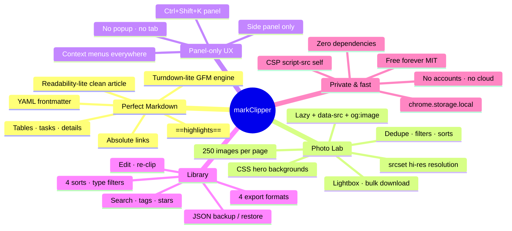

| Problem | markClipper answer |
|---|---|
| Read-it-later apps lock your clips in a cloud | Library is a local folder of bytes you can back up as one JSON |
| "Markdown export" full of junk nav/ads | Offline Readability-lite strips chrome before conversion |
| Broken relative links in notes | Every link and image is absolutized at clip time |
| Screenshots as opaque PNG blobs | Screenshot clip embeds a quota-safe downscaled copy as real Markdown |
| Photo galleries need right-click-per-image | Photo Lab grabs 250 at once, hi-res, deduped, downloadable |
| Popups steal focus | Panel-only UI — your page stays put |
| Telemetry in "private" tools | Zero network calls in the app code |

---

## Demo / How it looks

| Screen | What you see |
|---|---|
| Panel home | Floating topbar, pill tabs (Clip · Photos · Library · Power), status bar |
| Clip tab | Six capture buttons, per-clip note field, progress |
| Photos tab | Grid of thumbnails with WxH badges, select, filters, lightbox |
| Library | Search bar, type/star/tag filters, 4 sorts, preview/source/details |
| Preview | Rendered Markdown with real image thumbnails |
| Themes | Dark, light, system — full Heros token set |

> Screenshots welcome — open an issue or PR with captures.

---

## Feature Universe — The Complete List

90+ features across six groups. Every one is implemented in this repository.

### Capture (16)

| Feature | Trigger |
|---|---|
| Article clip (smart clean read) | Panel button · `Ctrl+Shift+A` · context menu |
| Full-page clip | Panel button · context menu |
| Selection clip | Select text first · `Ctrl+Shift+S` · context menu |
| Bookmark (title + URL) | `Ctrl+Shift+B` · context menu on link |
| Link clip | Right-click any link |
| Image clip (single, with caption + source) | Right-click any image |
| Photo Lab grab | Tab · `Ctrl+Shift+I` · context menu |
| Screenshot (visible tab, PNG/JPEG) | `Ctrl+Shift+P` · context menu |
| Gallery screenshot save | In lightbox / grid |
| Re-clip (refresh an existing note) | Library → note → Re-clip |
| Blocked-page bookmark fallback | Automatic when DOM is inaccessible |
| Context menus (page / link / image / selection) | Right-click |
| Global commands (6) | `chrome://extensions/shortcuts` |
| Progress toasts | Automatic |
| Empty-state guidance | Automatic |
| Smart filename templates | Settings |

### Photo Lab (26)

Up to **250 images/page** · `img`, `picture`/`srcset`, `data-src`, `data-lazy`, `og:image`, CSS hero backgrounds · hi-res URL resolution · skip icons/avatars toggle · skip data-URLs toggle · min-width slider · caption search · 3 sorts (size / order / name) · WxH badges · tap-select · select all / none · lightbox (prev/next, double-click open) · copy gallery Markdown · download one · download all via `chrome.downloads` · lazy + debounced 60 fps grid · dedupe by normalized URL · smart names · photo count in stats.

### Perfect Markdown (14)

H1–H6 · bold / italic / strikethrough · `==mark==` highlights · absolute links · absolute images · fenced code with language classes · GFM tables · task lists · blockquotes · `<details>` folds · YAML frontmatter (title, source, date, tags) · smart filename templates · paragraph spacing rules · whitespace normalization.

### Library (14)

Search (title + body + tags) · type filter · star filter · tag filter · 4 sorts · star / unstar · copy Markdown · delete (single + bulk) · preview tab · source tab · details tab · edit content · edit title + tags · 4 export formats · bulk export.

### Power tools (12)

Per-clip notes · per-clip todos · totals / sites / streak stats · photos-grabbed counter · images-in-notes counter · content widths · font scale · dark / light / system themes · status bar · progress indicators · toasts · empty states.

### Platform (8)

Manifest V3 · side panel only (`sidePanel`, no `default_popup`) · `chrome.storage.local` · CSP `script-src 'self'` · zero dependencies · offline-first · unlimited everything · MIT free forever.

---

## The Six Capture Modes

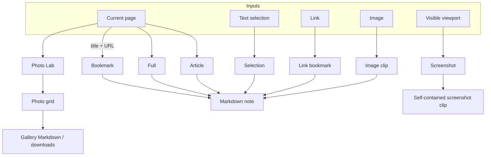

| Mode | What it extracts | Best for |
|---|---|---|
| **Article** | Main content only — nav, ads, footers, popups removed | Blog posts, docs, news |
| **Full** | Entire rendered page | Reference dumps, short pages |
| **Selection** | Exactly what you highlighted | Quotes, passages |
| **Bookmark** | Title + URL (+ optional note) | Link gardens, "read later" |
| **Image** | One image + caption + source link | Figures, memes, charts |
| **Screenshot** | Visible viewport PNG/JPEG embedded in the note | Layouts, apps, broken pages |

---

## Photo Lab Deep Dive

```mermaid
flowchart LR
    subgraph Harvest["Harvest (content-extract.js injected on demand)"]
      H1[img src]
      H2[picture source srcset]
      H3[data-src · data-lazy · data-original]
      H4[og:image · twitter:image]
      H5[CSS background-image heroes]
      H6[a[href] image files]
    end
    H1 & H2 & H3 & H4 & H5 & H6 --> N[Normalize URL + dedupe]
    N --> HIRES{hi-res enabled?}
    HIRES -->|yes| SRC[Pick largest srcset candidate]
    HIRES -->|no| KEEP[Keep src as-is]
    SRC --> FILT[Filters: min-width, icons, data-URLs]
    KEEP --> FILT
    FILT --> GRID[Grid: lazy, debounced, 60fps]
    GRID --> ACT[Select · search · sort]
    ACT --> LB[Lightbox]
    ACT --> DL[chrome.downloads bulk]
    ACT --> MD[Gallery Markdown clip]
```

| Setting | Effect |
|---|---|
| Hi-res resolution | Prefer the largest `srcset`/`data-srcset` candidate |
| Skip icons / avatars | Drop tiny decorative images by heuristic + dimensions |
| Skip data-URLs | Ignore inline base64 blobs (quota safety) |
| Include CSS backgrounds | Harvest `background-image` heroes |
| Captions | Attach alt text / figcaption / title to gallery Markdown |
| Min width slider | Client-side filter before grid render |
| Shot format | PNG or JPEG for screenshots |
| Embed downscale | Screenshot embeds capped at 1100px wide (storage-quota safe); original downloadable |

---

## markClipper vs Everyone Else

| Capability | markClipper | Browser bookmark | Read-it-later cloud | Other clippers |
|---|---|---|---|---|
| Output | Perfect Markdown + frontmatter | URL only | Proprietary save | ⚠️ often messy MD |
| Runs offline | ✅ | ✅ | ❌ | ⚠️ |
| Local-only storage | ✅ | ✅ | ❌ | ⚠️ sync required |
| Photo Lab (250/page, hi-res) | ✅ | ❌ | ❌ | ❌ |
| Screenshot → Markdown embed | ✅ | ❌ | ❌ | ❌ |
| Panel-only UI | ✅ | n/a | n/a | ⚠️ popups |
| Zero dependencies | ✅ | n/a | n/a | ❌ |
| Tags + search + stars | ✅ | ✅ weak | ✅ | ⚠️ |
| Export .md/.html/.txt/.json | ✅ all | ❌ | ⚠️ | ⚠️ |
| Backup = one JSON file | ✅ | ❌ | ❌ | ⚠️ |
| Free + unlimited + MIT | ✅ | ✅ | ❌ quotas | ⚠️ |

---

## Architecture and Diagrams

### System components

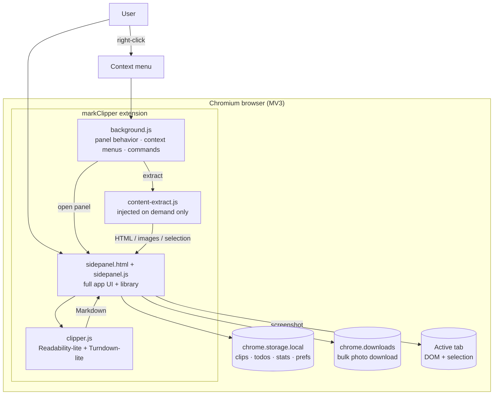

### Why panel-only?

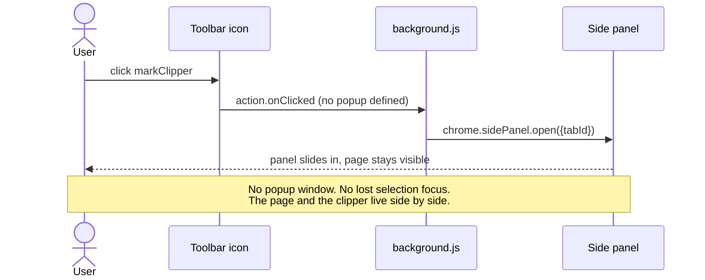

Manifest shape: `action` has **no** `default_popup`; `side_panel.default_path = sidepanel.html`; `background.js` opens the panel on icon click. That is the entire mechanism.

### Storage layout

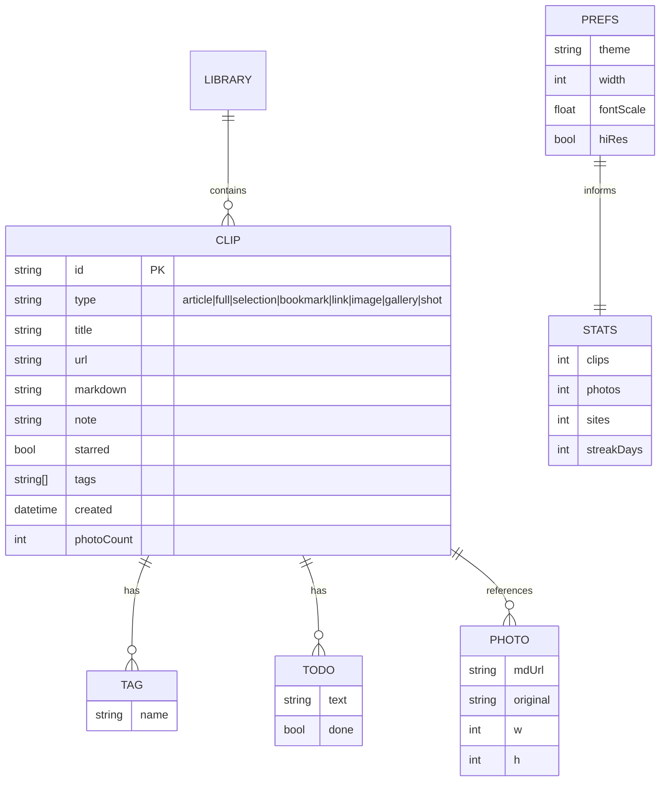

Key namespaces in `chrome.storage.local`: `clips` (array), `todos`, `stats`, `prefs`. Everything is JSON-serializable; backup exports a single file.

---

## The Markdown Pipeline — Readability → Turndown → Frontmatter

```mermaid
flowchart LR
    DOM[Tab DOM] --> EX[content-extract.js<br/>on-demand inject]
    EX --> RAW[Raw HTML blob<br/>title · byline · html · text · images]
    RAW --> RL[Readability-lite<br/>score paragraphs, strip nav/ads]
    RL --> CLEAN[Clean HTML subtree]
    CLEAN --> TD[Turndown-lite walk]
    TD --> RULES[Rules:<br/>headings · emphasis · links<br/>code · tables · tasks<br/>quotes · details · ==mark==]
    RULES --> MD[Markdown body]
    MD --> ABS[Absolutize links + images]
    ABS --> FM[YAML frontmatter<br/>title · source · date · tags]
    FM --> OUT[Final note .md]
```

| Stage | Responsibility |
|---|---|
| `content-extract.js` | Injected only when a clip runs (no always-on content scripts). Collects title, canonical URL, selection HTML, images and hero. |
| Readability-lite | Paragraph-weight scoring, candidate selection, removal of nav/footer/aside/ad selectors, script/style stripping. |
| Turndown-lite | Recursive DOM walk → GFM. Handles `pre/code`, tables, task list checkboxes, `mark`, `details/summary`. |
| Absolutizer | `new URL(href, base)` for every `a` and `img` — notes survive moving between apps. |
| Frontmatter | `title`, `source`, `date`, `tags`, `type` — Obsidian / Jekyll / Hugo ready. |
| Sanitizer | Drops `on*` handlers and `javascript:` URLs before conversion. |

---

## Sequence Flows — End-to-End Journeys

### Clip an article

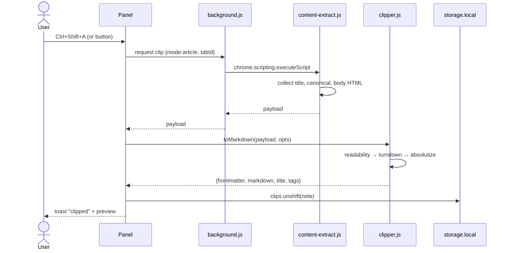

### Photo Lab grab

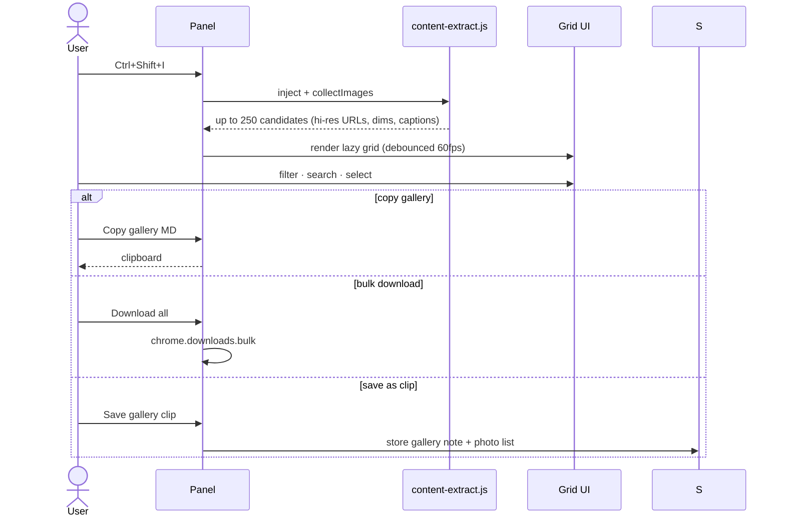

### Screenshot → self-contained note

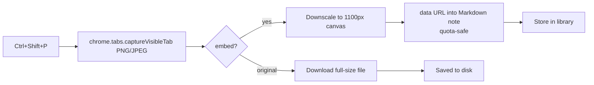

### Library lifecycle

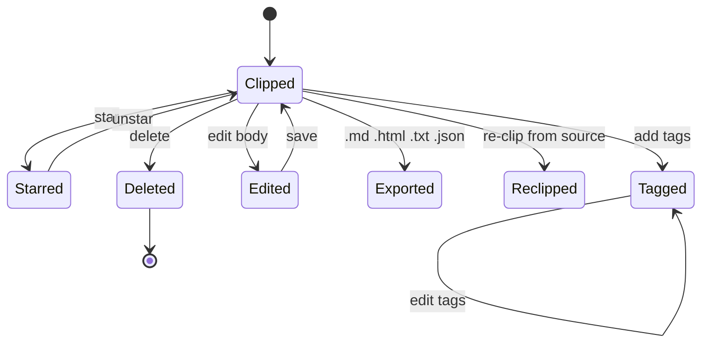

---

## Storage Model and Library

| Data | Key | Shape |
|---|---|---|
| Notes | `clips` | Array of clip objects (newest first) |
| Todos | `todos` | Array of `{text, done}` |
| Stats | `stats` | `{clips, photos, sites, streakDays, ...}` |
| Prefs | `prefs` | `{theme, width, fontScale, hiRes, ...}` |

- **Search** runs over title, body and tags with a single query string.
- **Filters** combine: type, starred, tag — plus 4 sort orders (newest, oldest, title, site).
- **Streaks** increment when you clip on consecutive days.
- **Quota safety**: screenshot embeds are downscaled; data-URL images can be skipped; the whole library stays JSON-exportable.

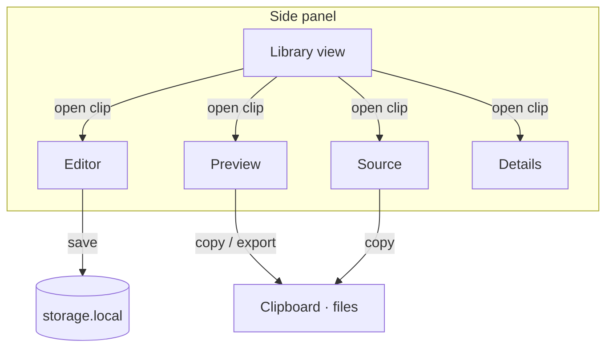

---

## Export and Backup Engine

| Format | Contains | Use |
|---|---|---|
| `.md` | Frontmatter + Markdown body | Obsidian, Git repos, any editor |
| `.html` | Rendered HTML page | Share, archive |
| `.txt` | Plain text | Quick paste |
| `.json` | Structured clip objects | Machine migration |
| Bulk export | All clips in chosen format | Whole-library moves |
| Backup / restore | One JSON with clips + todos + stats + prefs | New machine, disaster recovery |
| Clipboard | Raw Markdown of a clip or photo gallery | Instant paste |

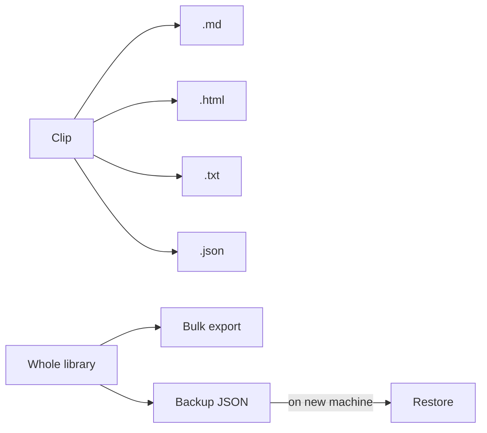

---

## Security Model

| Surface | Rule |
|---|---|
| Extension pages CSP | `script-src 'self'; object-src 'self'` — no inline, no remote scripts |
| Content scripts | None always-on; `content-extract.js` injected per clip via `scripting` |
| Clipboard | Written only on explicit user action |
| Downloads | Only via `chrome.downloads` on explicit user action |
| External HTML | Sanitized before Markdown conversion (no `on*`, no `javascript:`) |
| Network | Zero — the app never fetches anything itself |
| Storage | Local profile only; backup file never auto-uploaded |

---

## Privacy and Security

| Question | Answer |
|---|---|
| Do clips upload anywhere? | **No.** `chrome.storage.local` only. |
| Any analytics / telemetry? | **None.** No network code paths in the app. |
| Accounts? | **None.** |
| Who can read my library? | Anyone with access to your browser profile — same as bookmarks. |
| Backup safety? | The JSON backup is yours; store it wherever you like. |
| Site permissions? | `activeTab` + `scripting` for on-demand extraction; `<all_urls>` host permission for clip-anywhere. |

---

## Install — 30 Seconds

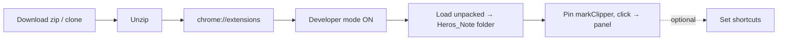

1. Download the [latest release ZIP](https://github.com/Ahmedbakr78/Heros_Note/releases/latest) or `git clone https://github.com/Ahmedbakr78/Heros_Note.git`.
2. Open `chrome://extensions` — Edge: `edge://extensions`, Brave: `brave://extensions`, Vivaldi: `vivaldi://extensions`, Opera: `opera://extensions`.
3. Enable **Developer mode**.
4. **Load unpacked** → select the `Heros_Note` folder (contains `manifest.json`).
5. Pin **markClipper**, click it → the **side panel** opens (no popup).
6. Optional: `chrome://extensions/shortcuts` → assign keys (defaults: `Ctrl+Shift+K` panel, `A` article, `S` selection, `B` bookmark, `I` photos, `P` screenshot).

**Mobile:** works as a full app in Kiwi Browser.

**Updating:** new folder → Reload ↻ on the card (version must read `1.1.0`).

---

## Usage Guide

| You want to… | Do this |
|---|---|
| Clip a clean article | Visit the page → panel → **Article** (or `Ctrl+Shift+A`) |
| Clip exactly what you selected | Select text → **Selection** (`Ctrl+Shift+S`) |
| Clip everything | **Full** |
| Save a link for later | Right-click link → markClipper → bookmark |
| Harvest a gallery | **Photos** tab → grab → select → copy MD / download / save clip |
| Screenshot the viewport into a note | **Shot** (`Ctrl+Shift+P`) |
| Add your own words | Per-clip **note** field, or Library → Edit |
| Organize | Tags + stars + type filters |
| Take it with you | Backup → JSON; or bulk export `.md` |
| Change look | Power tab → theme / width / font scale |

---

## Keyboard Shortcuts and Commands

| Keys | Action |
|---|---|
| `Ctrl+Shift+K` / `⌘⇧K` | Open markClipper panel |
| `Ctrl+Shift+A` | Clip article |
| `Ctrl+Shift+S` | Clip selection |
| `Ctrl+Shift+B` | Bookmark (title + link) |
| `Ctrl+Shift+I` | Grab photos |
| `Ctrl+Shift+P` | Screenshot visible page |

All six are MV3 `commands` — remap them at `chrome://extensions/shortcuts`.

In-panel: `Esc` closes overlays; search focuses with `/`.

---

## Context Menu Map

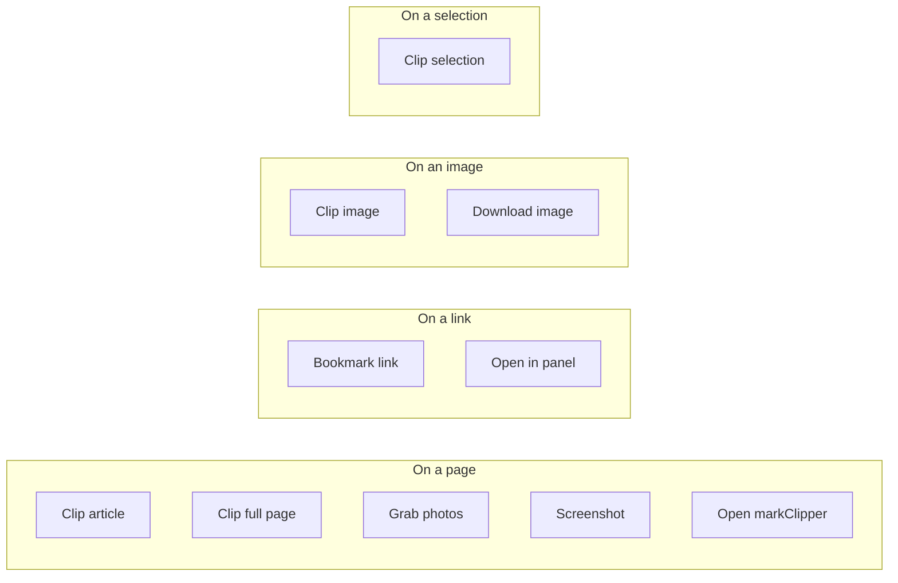

---

## Themes and Eye Comfort

| Control | Options |
|---|---|
| Mode | Dark · Light · System |
| Width | Multiple content widths for the preview column |
| Font scale | Slider, persisted |
| Status bar | Compact info strip, toggleable |

Full Heros token set: floating topbar, ultra-rounded cards, pill tabs, toasts, modals, chips — dark and light both first-class.

---

## Responsive and Mobile

| Surface | Behavior |
|---|---|
| Desktop panel | Full layout with tabs |
| Narrow panel | Tabs compress, grid drops to fewer columns |
| Kiwi Browser (Android) | Full extension support — clip from your phone |

---

## Performance Engineering

| Technique | Effect |
|---|---|
| On-demand content script | No always-on injection tax on every tab |
| Debounced 60fps grid | 250-image galleries scroll smoothly |
| Lazy image loading in grid | Only visible thumbnails decode |
| Dedupe before render | No duplicate network or DOM work |
| Minimal panel boot | Single HTML file + one JS — silent start |
| Storage writes batched | Avoid quota thrash |

---

## Error Handling and Resilience

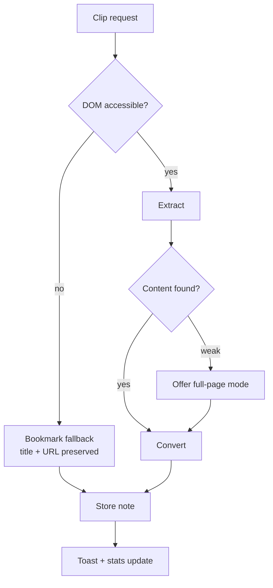

- Restricted pages (`chrome://`, Web Store, PDF viewer) → bookmark fallback with a clear toast.
- Blocked extraction (CSP-heavy SPAs) → fallback + suggestion to use selection mode.
- Download failures → per-file toast; the rest of the batch continues.
- Storage quota pressure → downscale embeds, skip data-URLs (settings).

---

## Accessibility

| Feature | Status |
|---|---|
| Keyboard commands | 6 global commands |
| Focus-visible rings | Yes |
| ARIA labels on icon controls | Yes |
| Semantic tabs / dialogs | Yes |
| Contrast-tuned dark + light | Yes |

---

## Internals — File by File

| File | Lines | Role |
|---|---|---|
| `manifest.json` | MV3 1.1.0 | Permissions: `sidePanel`, `activeTab`, `scripting`, `storage`, `contextMenus`, `tabs`, `downloads`; 6 commands |
| `sidepanel.html` | ~560 | Full app UI in the Heros design system |
| `sidepanel.js` | ~816 | Library, preview, export, Photo Lab UI, power tools, storage |
| `clipper.js` | ~444 | Offline Readability-lite + Turndown-lite + frontmatter + filename templates |
| `content-extract.js` | ~162 | On-demand injected extractor (DOM, images, selection, hero) |
| `background.js` | ~93 | Panel open on icon click, context menus, command routing, screenshot capture |
| `icons/` | 6 files | logo + 16/32/48/128 + apple-touch |

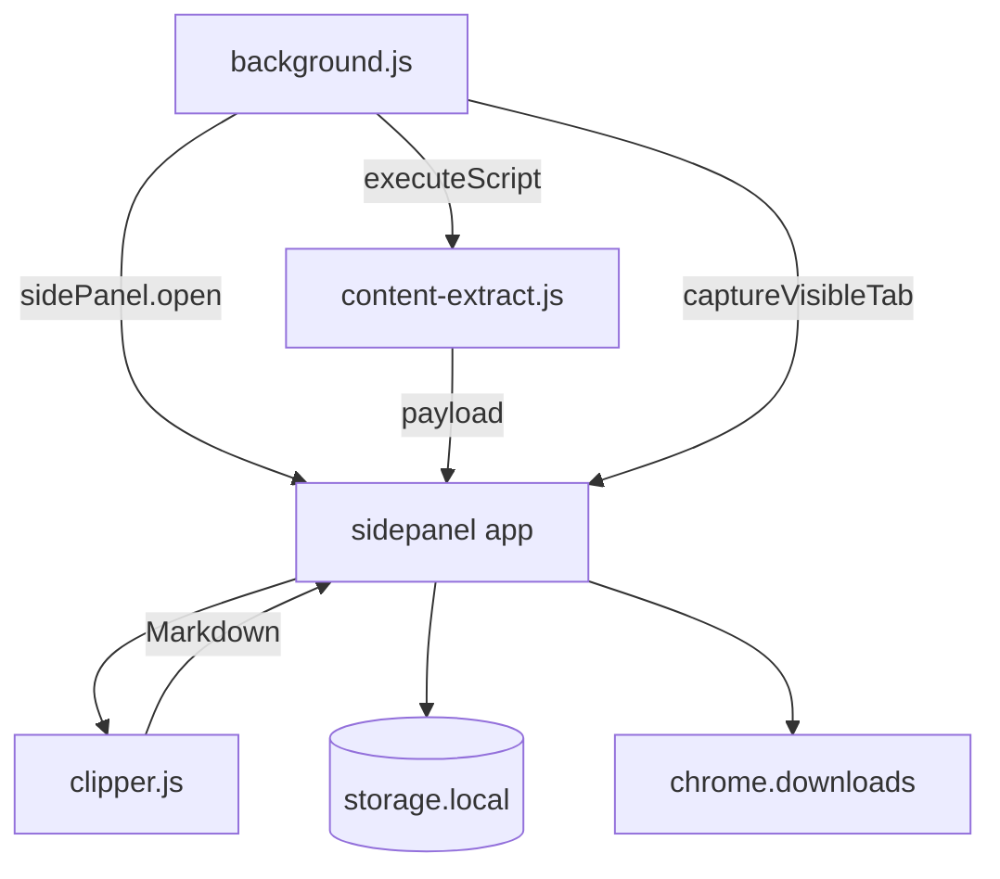

No build step. No npm. Load the folder and it runs.

---

## Compatibility Matrix

| Browser | Support | Notes |
|---|---|---|
| Chrome 114+ | ✅ | Side panel API native |
| Edge 114+ | ✅ | `edge://extensions` |
| Brave | ✅ | |
| Opera / GX | ✅ | |
| Arc | ✅ | |
| Vivaldi 6+ | ✅ | |
| Yandex | ✅ | |
| Kiwi (Android) | ✅ | Full app |
| Firefox | ❌ | No sidePanel API — roadmap for fallback window |

---

## Project Stats

| Metric | Value |
|---|---|
| Features | 90+ |
| Source lines (approx.) | ~2,000 |
| Runtime dependencies | 0 |
| Always-on content scripts | 0 |
| Network calls in app code | 0 |
| Storage | `chrome.storage.local` only |
| License | MIT |
| Price | Free, unlimited, forever |

---

## Repository Structure

```text
Heros_Note/
├── manifest.json        MV3 1.1.0 — panel-only, 6 commands, CSP self
├── sidepanel.html       Full app UI (Heros design system, ~560 lines)
├── sidepanel.js         Library · preview · export · Photo Lab · power (~816)
├── clipper.js           Readability-lite + Turndown-lite + frontmatter (~444)
├── content-extract.js   On-demand extractor, injected per clip (~162)
├── background.js        Panel behavior · context menus · commands (~93)
├── icons/               logo + 16/32/48/128 + apple-touch
├── docs/                GitHub Pages website
├── .github/             Issue templates · PR template · release notes
├── CHANGELOG.md         Every version
├── REPO_META.md         GitHub About / topics / pages source of truth
├── CONTRIBUTING.md      How to contribute
├── CODE_OF_CONDUCT.md   Contributor Covenant
├── SECURITY.md          Threat model + reporting
├── SUPPORT.md           Where to get help
└── LICENSE              MIT
```

---

## Tech Stack

| Layer | Choice | Why |
|---|---|---|
| Language | Vanilla ES2022 | Zero deps, auditable, fast |
| Platform | Manifest V3 | Chromium requirement, side panel API |
| Extraction | Readability-lite (own) | Offline, no vendor updates to chase |
| Conversion | Turndown-lite (own) | Full control of GFM rules |
| Storage | `chrome.storage.local` | Profile-local, JSON-native |
| Downloads | `chrome.downloads` | Real bulk file saves |
| Design | Heros PDF system tokens | Consistency across the suite |
| License | MIT | Free forever |

---

## Roadmap

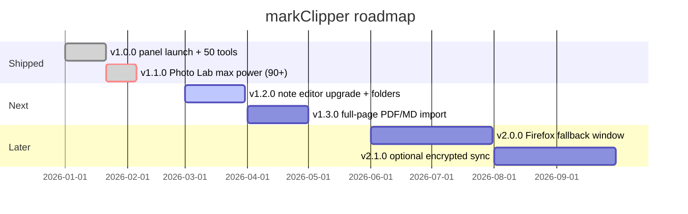

- **v1.2.0** — folders/notebooks, richer in-panel editor, scheduled re-clip
- **v1.3.0** — import PDFs and whole HTML files into the library
- **v2.0.0** — Firefox port (fallback window UI where sidePanel is missing)
- **v2.1.0** — optional end-to-end encrypted sync of the backup file (opt-in, still local-first)

---

## Contributing

See [`CONTRIBUTING.md`](./CONTRIBUTING.md). Keep the zero-dependency rule; extend `clipper.js` rules rather than pulling a Markdown library; update `CHANGELOG.md` and bump `manifest.json` for user-facing changes.

---

## FAQ — 30 Questions

1. **Is it free?** Yes — MIT, unlimited clips, photos and exports.
2. **Why only a side panel?** So the page you are clipping stays visible and your selection/focus is never stolen by a popup.
3. **Where are my notes stored?** `chrome.storage.local` in your browser profile.
4. **Any cloud?** No. Ever.
5. **Can I get my data out?** Any time — per-clip export, bulk export, or one JSON backup file.
6. **How many images can Photo Lab grab?** Up to 250 per page.
7. **Does it get hi-res versions?** Yes — srcset/data-srcset largest-candidate resolution, toggleable.
8. **Do screenshots blow the storage quota?** Embeds are downscaled to 1100px wide; originals download to disk.
9. **What is Readability-lite?** Our offline main-content extractor — no remote service, no vendor blob.
10. **Does it run on PDFs or `chrome://` pages?** No DOM to extract — you get a bookmark fallback.
11. **Can I edit a clip after saving?** Yes — Library → Edit (body, title, tags).
12. **Can I re-clip an updated article?** Yes — Re-clip refreshes from the source URL.
13. **Are links relative?** No — absolutized at clip time.
14. **Does code keep syntax classes?** Fenced code blocks with language tags survive conversion.
15. **Tables?** GFM tables, yes.
16. **Task lists?** Yes — checkboxes preserved.
17. **`==highlights==`?** Yes — `<mark>` becomes `==…==`.
18. **Frontmatter fields?** `title`, `source`, `date`, `tags`, `type`.
19. **Obsidian-compatible?** Yes — drop exported `.md` into a vault.
20. **Does it work offline?** Fully — there is nothing to be online for.
21. **Keyboard shortcuts?** Six commands, remappable in `chrome://extensions/shortcuts`.
22. **Context menus?** Page, link, image and selection variants.
23. **Mobile?** Yes, via Kiwi Browser.
24. **Firefox?** Not yet — v2.0 roadmap.
25. **How do tags work?** Freeform per clip; filter in the library by any tag.
26. **Streaks?** Daily clipping streak counter in stats.
27. **Can it clip only images?** Yes — single image clip or the whole Photo Lab.
28. **Bulk download reliability?** Uses `chrome.downloads` — real browser downloads, resumable by the browser.
29. **How do I report a bug?** [Issues](https://github.com/Ahmedbakr78/Heros_Note/issues/new/choose).
30. **Who makes it?** [Ahmed ABOBAKR](https://github.com/Ahmedbakr78) — the Heros suite (PDF, Markdown, Todo, NoteBook, Player).

More: [`SUPPORT.md`](./SUPPORT.md) · Security: [`SECURITY.md`](./SECURITY.md)

---

## Changelog and Releases

See [`CHANGELOG.md`](./CHANGELOG.md). Latest:

**v1.1.0 — Photo Lab max power**

- New **Photos tab**: grab up to 250 images/page (img, picture/srcset, data-src, lazy, og:image, CSS hero backgrounds), hi-res URLs, dedupe
- Photo grid: tap-select, All/None, min-width slider, hide-icons, caption search, 3 sorts, WxH badges, lazy + debounced 60fps
- Lightbox: fullscreen, prev/next, copy MD, download, open original, double-click open
- Gallery clips: `### Photo N` + image + caption + original Markdown, photo counts, bulk download, copy gallery MD
- Screenshot: visible-tab PNG/JPEG, in-panel preview, downscaled 1100px embed (quota-safe), save as self-contained clip
- Single-photo clip from right-click with caption + source link
- Settings: hi-res, skip icons/avatars, skip data-URLs, backgrounds, captions, min width, shot format
- In-app feature list now 90+; stats add photos grabbed + images in notes

**v1.0.0 — Panel launch**: panel-only app, five capture modes, perfect Markdown, library, power tools, 50+ features.

Publish:

```bash
gh release create v1.1.0 markclipper-v1.1.0.zip \
  --title "v1.1.0 — Photo Lab max power" \
  --notes-file .github/RELEASE_v1.1.0.md
```

---

## GitHub Topics, About and Website Setup

Source of truth: [`./REPO_META.md`](./REPO_META.md). Enable Pages: **Settings → Pages → Deploy from branch → `main` + `/docs`** → live at `https://ahmedbakr78.github.io/Heros_Note/`.

```bash
gh repo edit Ahmedbakr78/Heros_Note \
  --add-topic markdown --add-topic web-clipper \
  --add-topic chrome-extension --add-topic manifest-v3 \
  --add-topic side-panel --add-topic offline-first \
  --add-topic privacy --add-topic free --add-topic open-source \
  --add-topic note-taking --add-topic readability \
  --add-topic screenshot --add-topic photo-gallery \
  --add-topic obsidian --add-topic yaml-frontmatter \
  --add-topic dark-mode --add-topic javascript \
  --add-topic zero-dependencies --add-topic productivity \
  --add-topic clipper
```

---

## Related Projects

| Project | What it is |
|---|---|
| [Heros PDF](https://github.com/Ahmedbakr78/Heros_PDF) | PDF studio — design system markClipper was forged in |
| [Heros Markdown](https://github.com/Ahmedbakr78/heros-markdown) | Markdown viewer with LaTeX + every mermaid diagram |
| [Heros Todo](https://github.com/Ahmedbakr78/Heros_Todo) | Markdown + PDF + LaTeX side-panel studio |
| [Heros NoteBook](https://github.com/Ahmedbakr78/Heros_Jupter) | `.ipynb` viewer + Pyodide Python runner |
| [Heros Player](https://github.com/Ahmedbakr78/Heros_Music_Player) | Remote for YouTube Music / Spotify tabs |

---

## License and Credits

**MIT** — Copyright 2026 Ahmed ABOBAKR (Ahmedbakr78). See [`LICENSE`](./LICENSE).

Maintainer: [Ahmed ABOBAKR](https://github.com/Ahmedbakr78) · [LinkedIn](https://www.linkedin.com/in/ahmed-abo-bakr-1b2466288/)

Conceptual credits: the readability and turndown ideas follow the spirit of Mozilla Readability and Coreventions/GitHub turndown — reimplemented dependency-free for this extension.

---

<div align="center">

### If markClipper saves you time, star it — it takes 2 seconds and keeps us building.

[](https://github.com/Ahmedbakr78/Heros_Note/stargazers)
[](https://github.com/Ahmedbakr78/Heros_Note/fork)
[](https://github.com/Ahmedbakr78/Heros_Note/issues)

**Made with care by Ahmed ABOBAKR ([Ahmedbakr78](https://github.com/Ahmedbakr78) · [LinkedIn](https://www.linkedin.com/in/ahmed-abo-bakr-1b2466288/)) — free forever, private forever.**

</div>
